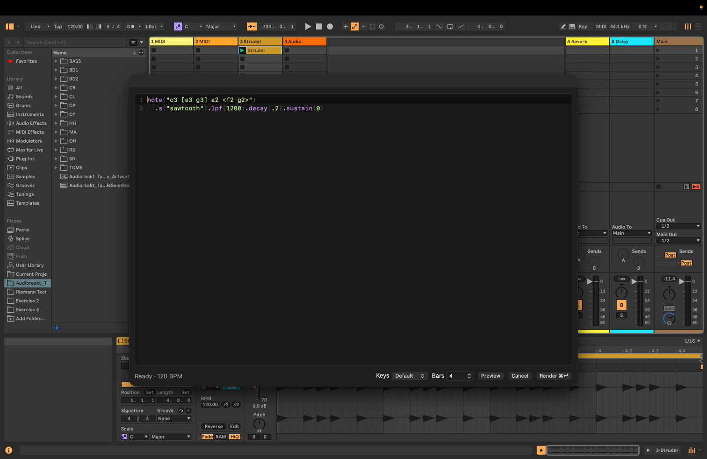

# strudel-live

An Ableton Live extension built with `@ableton-extensions/sdk` that renders
[Strudel](https://strudel.cc) code into audio clips. The code is stored inside
each clip's WAV file (in a custom `strd` RIFF chunk), so it is the clip's
source of truth and travels with the Live set.



## Get Started

Learn about building extensions: https://ableton.github.io/extensions-sdk/

## Setup

- The path to Ableton Live's Extension Host module is stored in `.env` as
  `EXTENSION_HOST_PATH`. The generator filled this in for you; edit it if your
  install moves.
- Turn on **Developer Mode** in Live's settings, or `npm start` will fail with
  "Failed to connect to Live within 10s".

## Usage

- Right-click an empty clip slot on an audio track → **New Strudel clip…**
- Right-click a Strudel audio clip → **Edit Strudel…** to change its code and
  re-render it. In Session View the new version goes into the next empty slot
  below (a scene is added if needed), so the original keeps playing; launch the
  new clip to switch on the next quantization boundary. Arrangement clips are
  replaced in place.

## How it works

- `src/extension.ts` registers the context menu actions and places rendered
  clips in Live.
- `src/server.ts` serves the editor UI on `127.0.0.1` and receives rendered
  audio from it.
- `ui/` is the editor dialog. It runs Strudel and renders patterns offline with
  an `OfflineAudioContext` at the song tempo (one cycle = one 4/4 bar).
- `src/wav.ts` writes 32-bit float WAVs with the `strd` chunk and reads it back.

## Scripts

```sh
npm start                  # build + run in Live's Extension Host
npm run build              # production build of the extension and UI
npm run build:dev          # dev build (sourcemaps, not minified)
npm run package            # build for production + create a .ablx archive
npm test                   # unit tests (Vitest)
npm run check              # typecheck + lint + format check + unit tests
npm run test:e2e           # build the UI + run the editor's browser tests (Playwright)
```

The browser tests drive the editor dialog in headless Chromium against the
real editor server, standing in for Live's dialog bridge. Install the browser
once with `npx playwright install chromium`. Anything that needs Live itself
still has to be checked by hand with `npm start`.

## License

This project is licensed under [AGPL-3.0-or-later](LICENSE), the same license
as [Strudel](https://codeberg.org/uzu/strudel), which it bundles.

The Ableton Extensions SDK and CLI are proprietary and are not included in
this repository. They are installed from `vendor/`, which you populate with
your own copy of the SDK.
